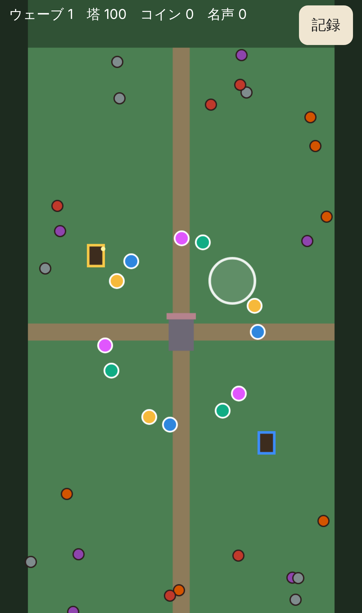

# 技術選定：開けて守れ！ タワーディフェンス

書いた人：game-preprod-tech（2026-11-25）。初版。
もとにしたもの：`進行表.md`、`開発チーム.md`、`01_企画/企画書.md`（第3版）、`01_企画/市場調査.md`（5. iPhone のブラウザ）、`02_プリプロ/デザインの柱.md`、`02_プリプロ/アートディレクション.md`（同時に作業中だったもの。画素の倍率・物の大きさ・同時に出る数を照らした）。
参考：同じオーナーの `games/yarikomi/02_プリプロ/技術選定.md`・`tech_check/`・`配布/`（乱数・保存の形・Service Worker・届け方の手順を流用した。yarikomi はターン制、このゲームはリアルタイムなので、描画とループは作り直した）。
前提（オーナーの決め）：iPhone の Safari（縦持ち）、ホーム画面の Web アプリ（PWA）としても／1人用・オフライン・サーバーなし／リアルタイムのタワーディフェンス／保存は端末内＋書き出し・読み込み。

**この文書の数字の読み方**：「（測った）」はこの環境で動かして出た数字。「（実機未確認）」は iPhone で確かめていないこと。印のない見積もりは推測。この環境には iPhone の実機も WebKit（Safari の中身）もなく、**すべて Chromium の iPhone のまね（画面の大きさ・画素比・タッチ・UA）**で確かめた（5.4）。

---

## 1. 結論

| 項目 | 選んだもの | 版（2026-11-25 に npm で確かめた） | ライセンス |
|---|---|---|---|
| 言語 | TypeScript | 7.0.2（型チェックだけ） | Apache-2.0 |
| ビルド | Vite | 8.3.8 | MIT |
| ゲームエンジン | **使わない**（ブラウザの機能だけ） | — | — |
| 描画 | **Canvas 2D**（1枚の Canvas。絵は1枚の大きな絵＝アトラスにまとめ、切り出して貼るだけ）。UI の板（ショップ・記録・設定）は DOM | ブラウザの機能 | — |
| 描画の予備 | PixiJS（WebGL）。描画の口（`Renderer`：`draw(world)` だけ）を同じにしてあり、**描画だけ**を差し替えられる。差し替える条件は 2.3 | 8.23.0 | MIT |
| 計算 | 固定の1歩（1/60 秒）。物は型付き配列（SoA）で持ち、毎フレーム new しない。当たりは 40px の升目 | 自作 | — |
| 大きな数 | **JS の number（倍精度）**。1e308 をこえたら Infinity を「∞」で見せ、保存もこわさない。ライブラリは今は使わない（3章） | — | — |
| 入力 | Pointer Events（1本の指だけ。押さえ続ける・ずらした輪） | ブラウザの機能 | — |
| 音 | Web Audio API の合成音（ファイルなし）。iOS の手当てつき（4.4） | ブラウザの機能 | — |
| 保存（端末内） | localStorage。1つのキーに、版の頭と指紋つきの文字列。ひとつ前の保存も残す | ブラウザの機能 | — |
| 保存（書き出し・読み込み） | 文字（コピー・貼り付け）と、テキストファイル（iOS は「共有」→「ファイルに保存」、使えなければダウンロード） | ブラウザの機能 | — |
| オフライン | Service Worker ＋ Web App Manifest（ホーム画面に置ける） | ブラウザの機能 | — |
| 乱数 | sfc32（yarikomi から流用。ウェーブごとに別の流れ） | 自作 | — |
| テスト | 計算の芯：`node --test`（Node 22.23.5）／画面：Playwright 1.63.0 ＋ Chrome for Testing 158.0.8127.36（この環境に入っているもの） | — | Playwright は Apache-2.0 |

**実行時に読み込む外部のライブラリはゼロ**（確認版のゲームの JS は 8.1KB、gzip 3.9KB（測った））。外部の CDN も使わない。PixiJS と break_infinity.js / break_eternity.js は、比べるためだけに確認版に入れた。

### 選んだ理由（短く）
1. **重さの中心は「描くこと」で、計算は軽い**。魔物 4,000・弾 3,900・粒 3,900（計 約1.2万）でも、1歩の計算は Node で 約1.9ms（測った、5.2）。決め手は描画の速さと、縦の画面で読める物の数
2. **この環境では Canvas 2D が PixiJS より速かった**（5.3）。ただしここの WebGL はソフトウェアの GPU（SwiftShader）なので、PixiJS に不利な比べ方になっている。JS 側の手間だけなら PixiJS のほうが 約半分で、物 4,600 では Canvas 2D の JS 側が 6〜8倍に跳ねたのに PixiJS はまっすぐだった（測った）。iPhone の GPU でどちらが速いかは**実機未確認**。だから、軽くて依存のない Canvas 2D で始め、描画の口を分けて、04 の実機の計測で足りなければ PixiJS に替える
3. **見た目の方向（アートディレクション：コードで描くベクター、部品のポーズを画面の外の Canvas に一度描いて使い回す）と同じ作り方**。アトラスに一度描いて貼る形は、Canvas 2D でも PixiJS でも同じ絵を使える
4. **小さく、オフラインに強い**。エンジンを入れると Phaser 4.2.1 の min.js だけで 約1.38MB、PixiJS 8.23.0 の min.js で 約0.91MB（yarikomi の技術選定と、`node_modules/pixi.js/dist/pixi.min.js` 912,519 B を確かめた）
5. **この環境で全部動かして確かめられる**（5章）

---

## 2. 候補の比較

### 2.1 比べた3つ

| | A：エンジンなし（TypeScript＋Canvas 2D＋Vite）**選んだ** | B：PixiJS 8.23.0（WebGL の 2D 描画） | C：Phaser 4.2.1（2D ゲームエンジン） |
|---|---|---|---|
| どんなもの | ブラウザの機能だけ | 描画のライブラリ（WebGL／WebGPU）。入力・音・場面は自分で | 場面・入力・音・読み込み・物理がそろったエンジン |
| 作りやすさ | 描画・ループ・入力・音を自分で書く（確認版で 約980行（PixiJS の描画 70行を含む）。yarikomi の保存・乱数を流用できる） | A とほぼ同じ量。描画だけ PixiJS に任せる | 場面の管理などがそろう。ただし計算を型付き配列で持つ作りとは別に、エンジンの物（GameObject）に合わせる手間がある。物理（Arcade/Matter）は使わない |
| 対象（iPhone の Safari・PWA） | 動く（Chromium のまねで確かめた。実機未確認） | 動く（同じ。実機未確認） | 動くとされる（ここでは動かしていない） |
| 性能（この環境・測った） | 物 1,350 個・画素比3 で 1フレーム 平均 9.8ms（5.3）。物 4,600 で JS 側が急に重くなる（崖がある） | 同じ条件で 37.7ms（ソフトの GPU のため）。JS 側は 1.2ms で A の 2.1ms より軽く、物 4,600 でも 3.3ms とまっすぐ伸びる | 測っていない |
| 大きさ（ライブラリだけ） | 0 | pixi.min.js 912,519 B（圧縮前） | phaser.min.js 1,375,976 B（圧縮前。yarikomi で確かめた値） |
| ライセンス | 自作（道具は MIT／Apache-2.0） | MIT（配布物の LICENSE を見た） | MIT（npm の登録） |
| 手元（この環境）で動くか | 動かして確かめた | 動かして確かめた（負荷の比べだけ） | npm から入る。動かしてはいない |

外した候補：
- **Godot 4 の Web 書き出し、Unity など**：読み込みが大きく、この環境にエディタも書き出しのひな形もなく、動かして確かめられない（yarikomi の技術選定 3章と同じ理由。Godot の Web は WebGL 2 だけで、スマホでは余裕が小さいと公式の文書にあるとされる。直接は開いていない）
- **DOM＋SVG（yarikomi の形）**：物が数百を超えると DOM の要素の数が重くなる。リアルタイムで多数を動かすこのゲームには合わない（測っていない。一般的な知識による推測）

### 2.2 なぜ A か（B との差）
- iPhone の Safari の Canvas 2D は GPU で描かれるとされるが、どこまで速いかは**実機未確認**。B の WebGL は物の数が多いときに強いのが一般的。今のところ、この環境で B が A に勝つ数字は出ていない（GPU がソフトのため）
- A は依存がなく、オフラインのとっておきも小さい。描画の口が `draw(world)` ひとつなので、B へ替えても計算・入力・保存・音は変わらない（確認版で両方を同じ `World` で動かした）

### 2.3 PixiJS に替える条件（04 の実機の計測で判断）
- 「目安の上限」（6章）の物の数で、iPhone の実機で 60fps を保てない（1フレーム 16.7ms のうち、描画に 10ms 以上かかる）とき
- アートディレクションの演出（光・粒・加算の合成）が Canvas 2D で重いとき
- 替える範囲は `render2d.ts` だけ。確認版の `renderPixi.ts`（約70行）がたたき台

---

## 3. 大きな数：1e308 をこえるか

### 3.1 決め（案。03 の `game-design-economy`・`game-spec-balance` が数の曲線を作るときに確かめる）
**こえないように設計する。JS の number を使う。** 理由：
1. **速さ**：1回の「当たり」の計算（耐久を減らす・倒れたか比べる・コインを足す）を 20万回で比べた（測った、Node 22、`npm run bench:num`）

   | | 1回 | number を 1 とした倍率 | 1フレームに当たり 2,000回 |
   |---|---|---|---|
   | number | 約1 ns | 1 | 0.002 ms |
   | break_infinity.js 2.2.0 | 約88 ns | 約94倍 | 0.18 ms |
   | break_eternity.js 2.2.2 | 約1,500 ns | 約1,500〜1,650倍 | 3.1 ms |

   break_eternity.js は1フレーム 16.7ms のうち 3ms を数の計算だけに使う。戦いの毎フレームの計算には向かない。さらに、どちらも計算のたびに新しい物を作るので、ガベージコレクションで止まる心配がある（止まりの長さは測っていない）
2. **このゲームの伸び方**：名声で強くなって、前の記録の先まで行く形（デザインの柱）。ランの中の数は毎回1から伸び直す。1e308 まで要るかは曲線しだいで、**要らないように曲線を作れる**（03 への条件：ふつうに遊べる範囲のいちばん大きい数を 1e300 未満にとどめる）
3. **こえたときもこわれない手当て**を入れてある：表示は「∞」、保存は Infinity をそのまま往復できる（ふつうの JSON は Infinity を null にしてしまう。確認版の保存は置き換えて往復する。テストで確かめた）

### 3.2 こえる設計にするなら（03 が「要る」と決めたとき）
- **break_infinity.js 2.2.0**（MIT。Copyright (c) 2019 Timothy Stiles。最後の公開は 2023-02-26）を、**名声・コインなど、毎フレーム計算しない数だけ**に使う。魔物の耐久・攻撃は number のまま、「桁の段」を別に持つ（例：ウェーブが進むと単位が1つ上がる）
- break_eternity.js 2.2.2（MIT。同じ作者。2026-11-13 に公開）は 1e308 のさらに先（e の e）まで扱えるが、遅い。このゲームでは要らない見込み

### 3.3 表示
- 縦の画面の上の端で短くする案（確認版 `src/core/num.ts`）：9999 まではそのまま、その先は「1.23万」「3.4兆」「5.6京」、1e20 からは「1.2e20」。1〜1e308 のどの数でも **6文字以内**（測った：いちばん長いのは「1.0e20」）。どこから e 表記にするか、字の形は 03（`game-design-ux`）

---

## 4. 選んだ構成の決まり（05 本格的な開発開始への申し送り）

### 4.1 フォルダの分け方（確認版の形。本番は game-prod-architect が決める）
```
src/core/   戦場の計算・乱数・保存の形・数の表記（DOM・時間・Math.random を使わない。Node でテストできる）
src/        描画（render2d / renderPixi）・ループ・入力・音・画面（core を呼ぶだけ）
public/     sw.js（オフライン）、manifest、アイコン
test/       core のテスト（node --test）、画面のテスト・負荷の確かめ（Playwright）
```

### 4.2 ループと計算
- 計算は固定の1歩（1/60 秒）、描くのは `requestAnimationFrame` のたび。描画が 30fps に落ちても（iOS の低電力モードは rAF を 30fps にする。WebKit の技術者がわざとだと説明している：[WebKit Bug 215745](https://bugs.webkit.org/show_bug.cgi?id=215745)、[popmotion の記事](https://popmotion.io/blog/20180104-when-ios-throttles-requestanimationframe)）、1回の描画で2歩進めるので、ゲームの速さは同じ。1回の描画で進めるのは5歩まで（それ以上遅れたら、遅れを捨てる）
- 物は型付き配列（`Float32Array` など）で持ち、消すときは末尾と入れ替える。毎フレーム new しない
- 当たりは 40px の升目に魔物を入れて、近くの升目だけ調べる
- 乱数はシード付き。ウェーブごとに `シード/w番号` で別の流れにする（ウェーブの始まりから戻っても、同じ出方。テストで確かめた）

### 4.3 描画
- **画素の倍率の上限は 2**（アートディレクション 未決 #3 への答え）。iPhone の多くは 3 だが、3 だと描く画素の数が 2.25倍になる。この環境で、画素比3→2 で「画素に落とす」時間が 約3〜4割減った（5.3）。にじみは 04 の実機で見る。にじまないことが大事な画面（図鑑など、DOM の板）は DOM なので影響しない
- 絵は、ゲームが始まるとき（と画面の大きさが変わったとき）に、端末の画素の大きさでアトラスに一度描く。毎フレームは `drawImage` で貼るだけ。部品のポーズ（アートディレクション 5.4）も同じ形でアトラスに入れる
- ダメージの数などの数字は、毎回 `fillText` を呼ばず、字の絵を並べる（確認版の `GLYPHS`）
- 背景は1枚の絵にして、毎フレーム1回貼る
- 戦場は1枚の Canvas、HUD・ショップ・記録の板は DOM（日本語の文・ボタンの押しやすさ・読み上げのため）

### 4.4 音（iOS の手当て）
| 問題 | 出典 | 手当て（確認版に入れた） | 確かめた範囲 |
|---|---|---|---|
| 人の操作まで AudioContext は止まっている | 市場調査 5 | 最初の `pointerdown` と `touchend` の中で作って `resume()`、無音を1つ鳴らす。「タップで始める」「タップで再開」の板を置き、必ず1回タップさせる | Chromium で running になる（測った）。実機未確認 |
| 裏から戻ると `interrupted` や `suspended` のまま。`resume()` が効かない報告 | [MDN：BaseAudioContext.state](https://developer.mozilla.org/en-US/docs/Web/API/AudioContext/state)、[WebKit Bug 263627](https://bugs.webkit.org/show_bug.cgi?id=263627)、[WebKit Bug 273511](https://bugs.webkit.org/show_bug.cgi?id=273511) | 裏に回ったら `suspend()`、戻ったら「タップで再開」のタップの中で `resume()` | Chromium で、裏→戻る→タップで running（測った）。実機未確認 |
| **iOS 26 のホーム画面アプリで、2回めの起動から Web Audio が鳴らない／`resume()` が返ってこない** | [WebKit Bug 291892](https://bugs.webkit.org/show_bug.cgi?id=291892)（検索の結果の要約による。2025-09-29 のコメントで iOS 26 の公開版でも起きると報告。直ったかは**わからない**）、関連：[WebKit Bug 295518](https://bugs.webkit.org/show_bug.cgi?id=295518) | `resume()` が 0.6 秒で running にならなければ、その AudioContext を閉じて捨て、次のタップで新しく作る | 「resume が返らない」をまねて、作り直し→次のタップで running になる筋道は確かめた（測った）。**実機で直るかは未確認**。直らないときの最後の手は「ホーム画面から消して入れ直す」（報告者の回避） |
| マナーモード（消音スイッチ）で Web Audio が鳴らない | [WebKit Bug 261554](https://bugs.webkit.org/show_bug.cgi?id=261554)、[MDN：AudioSession.type](https://developer.mozilla.org/docs/Web/API/AudioSession/type) | 今は何もしない（マナーモードなら鳴らない＝ふつうのゲームと同じ）。設定に「マナーモードでも鳴らす」を置くなら `navigator.audioSession.type = 'playback'`（iOS 17 以降とされる。ほかのアプリの音楽を止める） | 未確認。置くかは未決（7章） |
| 後半、当たりの音が何百も重なる | — | 同時に鳴る音を 12 まで、同じ音の間隔の下限（当たり 0.05 秒）。アートディレクションの「同じ音は同時に4つまで、指の攻撃は3つ」に合わせて 05 で直す | 呼び出しの数を数えた |
| iOS は振動が使えない | 市場調査 5 | 使わない（企画書のとおり） | — |

検証：合成の効果音は `OfflineAudioContext` でも同じ音を作れるようにして、波形が無音でないことを確かめた（最大 0.3 前後。測った）。**耳で聞こえるか、iPhone のスピーカーで鳴るかは実機未確認**。

### 4.5 入力
- Pointer Events。1本めの指だけを使い、2本めは無視（デザインの柱「指を2本以上使う操作は入れない」）
- 押さえているあいだ、6歩（0.1 秒）ごとに輪の中の魔物とパックを攻撃。輪は指の上に `ringOffset`（論理px）ずらす。確認版は 48、アートディレクションは「指の 56px 上、設定で 0／40／56／72」なので、本番はそれに合わせる。当たりの半径 34（見た目 28 の 1.2 倍）
- Canvas に `touch-action: none`、`touchstart`・`touchmove`・`gesturestart`・`dblclick`・`contextmenu` の既定の動作を止める。`-webkit-touch-callout: none`、`user-select: none`。viewport は拡大なし。**長押しの虫眼鏡・文字の選択が iPhone で本当に出ないかは実機未確認**
- 指を離した・`pointercancel`・`lostpointercapture` で攻撃を止める（通知や着信で指がとられたときに、押しっぱなしにならない）

### 4.6 保存
- **書く時**：ウェーブが始まった瞬間と、ショップが開いた瞬間だけ（デザインの柱 #16 の案のとおり）。ショップで買ったときも書く
- **書く中身**：版、ランのシード、ウェーブ、場面（ウェーブ／ショップ）、コイン、塔の耐久、名声、英雄の位置と種類、次に降るパック、設定。英雄 60人・パック 8 で 約1,150文字（測った）。魔物の位置は書かない
- **形**：`PD1.<JSON を base64url>.<FNV-1a の指紋>`。読み込みで、頭の版と指紋を照らし、合わなければ断る。Infinity・NaN をこわさずに往復させる
- **前の保存も残す**：書く前に今の保存を `.prev` に写す。今のが読めなければ前のを読む
- **書けなかったとき**（容量オーバーなど）：ゲームは止めず、HUD に「保存できません」と出す（書き出しを促す）
- **裏に回ったら**：保存はせず、一時停止して「タップで再開」を出す。iOS がタブを閉じても、戻るのは今のウェーブの始まりから（最大 約2分を失う）
- **ウェーブの途中から戻る形**（デザインの柱 未決 G への見積もり）：魔物・弾の位置まで書くのは、1回 数十KB（魔物 500・弾 500 で、数を書く量から見積もり。測っていない）。書くこと自体は軽いが、①英雄の狙い・弾の飛び方などすべての状態を漏れなく書く手間、②版が変わったときに古い途中の保存を読む手間が増える。**「ウェーブの始まりから」のままを推す**。後半のウェーブが2分をこえるなら考え直す
- `navigator.storage.persist()` を最初のタップで呼ぶ（この環境では `false` だった。**iPhone では未確認**。WebKit はホーム画面のアプリかなどで判断するとされる：yarikomi の技術選定 R2）
- IndexedDB は今は使わない（保存が数KBなので localStorage で足りる）

### 4.7 書き出し・読み込み
- 文字：「文字をコピー」（`navigator.clipboard`、だめなら選んで長押し）／貼って「読む」
- ファイル：iOS は `navigator.share({ files })` で共有シートを出し、「ファイルに保存」できる（iOS Safari は files の共有に iOS 14 以降で対応と [caniuse](https://caniuse.com/mdn-api_navigator_canshare_data_files_parameter) にある。**実機未確認**）。使えなければダウンロード。ファイル名は英数字だけ（yarikomi で日本語のファイル名が `download` になったため）
- 読む：ファイルを選ぶ／貼った文字

### 4.8 オフライン・PWA
- Service Worker：一度読んだものをとっておき、次から返す。**同じ住所から、転送されず、成功したものだけ**とっておく（Cloudflare Access のログイン画面をとっておかないため。R9）。版ごとにとっておく場所の名前を変え、古いのは消す
- manifest：`display: standalone`、`orientation: portrait`、アイコン 180px（仮）。`<link rel="manifest" crossorigin="use-credentials">`（Access の後ろでも manifest を読めるように。R9）
- Service Worker は https か localhost でしか動かない（yarikomi R10 と同じ）

---

## 5. 最小の「動く」を作って確かめた

置き場所：`02_プリプロ/tech_check/`（捨てる前提）。
中身：縦の戦場（論理 360×720）、中央の塔、四方から来る魔物、押さえ続けると指の少し上の輪で攻撃、パックを輪で開けると英雄が立って自動で撃つ、ウェーブ（20秒）→ショップ（パックを買う）→次のウェーブ、保存、裏に回ったら一時停止、書き出し・読み込み、合成音、オフライン。負荷の確かめの画面（`bench.html`）は、物の数を決めて Canvas 2D と PixiJS で同じものを描く。



（戦場の左右の暗い帯は、確認版が論理 360×720 を縦に合わせて置いているため。本番はアートディレクション 5.1 の「横幅に合わせる」にする）

### 5.1 動かし方（このフォルダで）
```
cd games/packdefense/02_プリプロ/tech_check
npm install            # vite 8.3.8, typescript 7.0.2, pixi.js 8.23.0, break_infinity.js 2.2.0, break_eternity.js 2.2.2
npm run typecheck      # tsc -p .
npm test               # node --test test/core.test.ts（計算の芯、保存、数の表記、計算の速さ）
npm run bench:num      # 大きな数の速さの比べ
npm run build          # vite build → dist/
npm run e2e            # node test/e2e.mjs（iPhone 17 と iPhone SE（第3世代）相当で確かめる）
npm run perf           # node test/perf.mjs（物の数ごとのフレームの時間。10分ほどかかる）
npm run dev            # 手で触るとき（http://localhost:5173/ 、負荷は /bench.html?e=500&b=500&p=500）
```
`node_modules/`・`dist/`・`test-results/` は git に入れない（`.gitignore`）。

### 5.2 計算の芯（`npm test`）：12/12 通った
`npm run typecheck`：エラーなし。`npm run build`：ゲームの JS 8,122 B（gzip 3.87KB）。

| テスト | 結果 |
|---|---|
| 乱数：同じシードなら同じ列 | 通る |
| 同じシードなら、同じウェーブは同じ出方・同じ結果（20秒ぶん） | 通る |
| 攻撃の輪は指の上に 48 ずれる／ずらし 0 も選べる／上の端（数字の帯）より上に出ない | 通る |
| 押さえ続けると 1秒で 10回当たる。指の真下（輪から 48 離れた）魔物には当たらない。離したら止まる | 通る |
| 当たりは半径 34：中心から 32 は当たり、36 は外れ | 通る |
| パックは輪で5回攻撃すると開き、その場にそのレア度の英雄が立つ。開封の音のきっかけが出る | 通る |
| 保存：書き出し→読み込みで同じ。名声が Infinity でもこわれない（ふつうの JSON だと null になることも確かめた） | 通る |
| 保存：1文字変えた・途中で切れた・違う版の頭は断る | 通る |
| 保存：前の保存も残る。今のがこわれていたら前のを読む。容量オーバーは false を返す | 通る |
| 保存の大きさ：英雄 60人・パック 8 で 1,151文字 | 通る（3KB 未満） |
| 数の表記：1〜1e308 で 6文字以内（いちばん長いのは「1.0e20」）、Infinity は「∞」 | 通る |

**計算だけの速さ**（Node 22、この環境の CPU：Intel Xeon 2.1GHz、測った。描画は入っていない）：

| 魔物 | 弾 | 粒 | 英雄 | 計 | 1歩 |
|---|---|---|---|---|---|
| 250 | 247 | 245 | 26 | 773 | 0.14 ms |
| 500 | 491 | 487 | 51 | 1,533 | 0.07 ms |
| 1,000 | 980 | 970 | 97 | 3,049 | 0.20 ms |
| 2,000 | 1,965 | 1,949 | 97 | 6,012 | 0.58 ms |
| 4,000 | 3,939 | 3,881 | 97 | 11,916 | 1.89 ms |

計算は重さの中心ではない。1フレーム 16.7ms のうち、物 6,000 でも 1ms 未満。

### 5.3 フレームの時間（`npm run perf`）
条件：Playwright の `iPhone 17`（表示 402×681、タッチ、iPhone の UA）、Chrome for Testing 158（ヘッドレス）。CPU の遅さはそのまま（×1）と、Chrome の機能で4倍遅くしたもの（×4）。GPU は **SwiftShader（ソフトウェア）**。60フレームならしてから180フレーム測った。Canvas の内部の大きさは、画素比3 で 1206×2043、画素比2 で 804×1362。
「合計」＝計算＋描く（JS）＋画素に落とす（1画素を読み出して、描いたものを画素にするまで待った時間）。60fps に要るのは合計 16.7ms 未満。

物の数の段（魔物・英雄・弾・粒・数字・パック）：
L1 計 326（100・16・100・100・〜20・4）／L2 計 756（250・32・250・250・30・6）／L3 計 1,350（500・48・500・500・40・8）／L4 計 2,446（1,000・64・1,000・1,000・60・8）／L5 計 4,635（2,000・96・2,000・2,000・80・8）

**Canvas 2D（選んだ形）** 1フレームの合計 平均（ms）。かっこは 17.5ms をこえたフレームの割合

| | L1 | L2 | L3 | L4 | L5 |
|---|---|---|---|---|---|
| 画素比2・CPU×1 | 3.1（0%） | 4.8（0%） | 8.0（0%） | 14.1（3%） | 24.3（50%） |
| 画素比3・CPU×1 | 4.3（0%） | 6.3（0%） | 9.8（0%） | 14.9（2%） | 29.4（77%） |
| 画素比2・CPU×4 | 12.2（2%） | 21.3（51%） | 31.9（98%） | 62.1（100%） | 104.8（100%） |
| 画素比3・CPU×4 | 19.3（62%） | 30.9（99%） | 48.8（100%） | 79.1（100%） | 153.0（100%） |

**PixiJS 8.23.0（比べ）**

| | L1 | L2 | L3 | L4 | L5 |
|---|---|---|---|---|---|
| 画素比2・CPU×1 | 10.2（0%） | 12.9（3%） | 16.0（22%） | 23.8（72%） | 37.6（100%） |
| 画素比3・CPU×1 | 22.9（100%） | 27.5（100%） | 37.7（100%） | 46.8（100%） | 71.0（100%） |
| 画素比2・CPU×4 | 12.3（49%） | 15.8（71%） | 20.7（96%） | 30.5（100%） | 51.7（100%） |

**ことわり**：上の2つの表（全部の段）は、弾を目標の数まで撃ち足す直しを入れる前のビルドで測った。弾は目標より少なく（100〜250ほど）、表の「計」の数（326・756・1,350・2,446・4,635）が実際に出ていた物の数。直したあとに L2〜L4 を測り直した結果（弾も目標どおり、計 812・1,569・3,087）：

| 合計 平均（17.5ms 超） | L2（812） | L3（1,569） | L4（3,087） |
|---|---|---|---|
| Canvas 2D・画素比2・CPU×1 | 4.1（0%） | 6.5（0%） | 11.6（0%） |
| Canvas 2D・画素比2・CPU×4 | 15.3（15%） | 31.6（98%） | 56.4（100%） |
| Canvas 2D・画素比3・CPU×1 | 5.5（0%） | 8.7（0%） | 15.4（3%） |
| PixiJS・画素比2・CPU×1 | 12.5（2%） | 15.9（20%） | 23.8（70%） |
| PixiJS・画素比2・CPU×4 | 14.9（62%） | 20.0（90%） | 30.0（99%） |

物の数あたりの重さは、直す前とほぼ同じだった。結論（目安と上限）は変わらない。

**JS 側だけ（計算＋描く。GPU の差を除いた手間）** 画素比2（ms）

| | L1 | L2 | L3 | L4 | L5 |
|---|---|---|---|---|---|
| Canvas 2D・CPU×1 | 0.65 | 1.20 | 2.35 | 4.07 | **19.28** |
| Canvas 2D・CPU×4 | 2.49 | 5.27 | 8.51 | 16.00 | **81.24** |
| PixiJS・CPU×1 | 0.35 | 0.54 | 0.83 | 1.71 | 3.19 |
| PixiJS・CPU×4 | 1.72 | 2.86 | 4.34 | 7.70 | 15.77 |

読み方：
- PixiJS の合計が重いのは、ソフトの GPU で画面全体を塗る手間（L1 でも 10〜22ms）。iPhone の GPU ならこの部分はずっと小さいはず（**実機未確認**）
- Canvas 2D は L4（約2,400）と L5（約4,600）のあいだに崖があり、JS 側が 5〜8倍に跳ねた（Chromium の Canvas の作り方によると見られる。原因は確かめていない。Safari で同じかは**わからない**）
- 画素比3→2 で、Canvas 2D の CPU×4 の合計が 約3〜4割減った。PixiJS（ソフトの GPU）では半分以下になった
- 計算は全体のうち小さい（L4・CPU×4 でも 1.3ms）
- CPU×1・×4 のどちらが iPhone に近いかは**わからない**。最近の iPhone の CPU はこの環境（Xeon 2.1GHz）と同じくらいか速いと見られるが、測っていない。×4 は「古い機種・熱で遅くなったとき」の安全側の目安として見る
- この負荷の物は確認版の小さい絵（魔物 15px ほど）。アートディレクションの大きさ（ふつうの魔物 28〜36px）なら塗る画素は 3〜5倍になる

負荷の画面（L3、画素比3）は `test-results/bench_L3.png` にできる（git に入れない）。**L3 の時点で、魔物と弾と粒が重なって画面がほとんど読めなかった**。性能より先に、読みやすさで上限が決まる見込み（6章）。

### 5.4 画面の確かめ（`npm run e2e`）：70/70 通った
画面：①`iPhone 17`（表示 402×681、画素比3）、②`iPhone SE (3rd gen)`（375×667、画素比2）。どちらも Playwright の設定で、中身は Chromium。タッチは CDP で指の動きを送った。

| 確かめたこと | 結果（2つの画面とも） |
|---|---|
| はじめは止まっていて「タップで始める」。タップで始まり、AudioContext が running | 通る |
| 数字（HUD）が上の端（y=6〜50）。横スクロールなし | 通る |
| 押さえると、輪が指の 48 上に出る（指 y=298 → 輪 y=250） | 通る |
| 押さえ続けると、60歩（1.00秒）で 10回攻撃 | 通る |
| 指の真下の魔物には当たらない | 通る |
| ページが拡大・スクロールされない | 通る |
| 2本めの指では輪が動かない／指を動かすと輪がついてくる／離すと止まる | 通る |
| パックを押さえ続けると開き、英雄が立つ。開封の音の呼び出し | 通る |
| 合成音を OfflineAudioContext で作り、無音でない（最大 0.34） | 通る |
| `resume()` が返らないのをまねると、AudioContext を作り直し、次のタップで running | 通る |
| 裏に回ったら（visibilitychange をまねた）一時停止して時間が進まない、音を止める。戻ると「タップで再開」、タップで動き出して音も running | 通る |
| ショップが開いた瞬間に保存。ボタン 44px | 通る |
| ウェーブの始まりで保存（買ったパック2つ、コイン 4） | 通る |
| 再読み込みで、そのウェーブの始まりから（ウェーブ・パック・英雄が同じ） | 通る |
| 書き出しの文字（265文字）。ファイルの書き出し（共有が使えないので、ダウンロード。中身が文字と同じ） | 通る |
| 1文字変えた文字は断る／保存を消したあと、文字から・ファイルから読んで元どおり | 通る |
| 名声が 1e308 をこえても（Infinity）、保存・読み込み・表示（「∞」）がこわれない | 通る |
| オフライン：Service Worker が付いたあと、ネットを切って開き直しても動く | 通る |
| `navigator.storage.persist()` の結果 | `false`（記録だけ） |
| ふつうのウェーブ（物 40ほど）で、フレームの間隔 平均 16.7ms、17.5ms 超 0/150 | 通る |
| ページのエラーなし、外への通信なし | 通る |

途中で見つけて直したこと：
1. **「記録」を開くと、「タップで再開」の覆いが記録の板の上にかぶさって、何も押せなかった**（E2E で見つけた）。記録の板を開くときは覆いを出さず、閉じたときに出すようにした。本番でも、一時停止の覆いと板の重なりに気をつける
2. 確認版の Canvas に描いた数字と、DOM の HUD が重なっていた（スクリーンショットで見つけた）。ゲームの画面では Canvas の数字を描かないようにした
3. 最初の保存のとき、戦場を作る前に HUD を書こうとしていた（コードを読み直して見つけた）

### 5.5 確かめられなかったこと（正直に）
- **実機**：iPhone では一度も動かしていない。この環境に実機がない
- **WebKit（Safari の中身）**：Playwright の WebKit を入れようとしたが、配布元（cdn.playwright.dev、playwright.download.prss.microsoft.com）への接続がこの環境で許されておらず（403）、入らなかった。iPhone 相当の試験は、画面の大きさ・画素比・タッチ・UA が iPhone なだけで、中身は Chromium
- **GPU**：この環境の WebGL はソフトウェアの GPU（SwiftShader）。Canvas 2D もソフトで描かれていると見られる。iPhone の GPU での速さは測れていない。数字は「Canvas 2D と PixiJS の JS 側の手間の比べ」と「物の数を増やしたときの伸び方」として読む
- **音が耳に聞こえるか**、マナーモード、iOS 26 のホーム画面アプリで鳴らない件（R4）
- **ホーム画面に追加したときの動き**、iOS の保存が消える条件、`storage.persist()` の iPhone での結果
- **長押しの虫眼鏡・文字選択・ダブルタップの拡大**が iPhone で出ないか
- **低電力モード（30fps）**での手ざわり（計算は固定の1歩なので速さは変わらない、まではテストで確かめた）
- **熱で遅くなる**、電池の減り、何時間も遊んだときのメモリ
- **WebKit bug の今の状態**：bugs.webkit.org はこの環境から開けなかった（名前が引けない）。bug の中身は検索の結果の要約で確かめた。人が開いて確かめ直すこと

---

## 6. 画面に出る物の上限の目安（03 への申し送り）

**目安（案）：同時に画面に出る物は 計 800 まで、決して越えない上限は 計 1,500。** 実機の数字で 04 に決め直す。

| 物 | 目安 | 上限 | メモ |
|---|---|---|---|
| 魔物 | 250 | 500 | 大物は同時に1〜2体（アートディレクション） |
| 英雄 | 32 | 48 | 企画書の英雄は12〜16種。重複は数でなく強さにまとめる（デザインの柱） |
| 弾 | 250 | 500 | 見た目の弾。こえたら、見えない弾（当たりだけ）か、弾をまとめる |
| 粒（光・破片） | 250 | 400 | 開封の大きな光は同時に1つ（アートディレクション） |
| ダメージの数 | 12 | 12 | アートディレクションの決め |
| パック | 8 | 8 | デザインの柱「1ウェーブに数個まで」 |
| 計 | 約800 | 約1,500 | |

理由：
1. この環境で、CPU そのまま（×1）なら Canvas 2D で 計 2,400（L4）まで 60fps に近い（合計 14ms）。CPU×4 では 計 326（L1）までしか保てない。iPhone はその間のどこかと見て、目安は L2（756）、上限は L3（1,350）あたりに置いた
2. 確認版の絵は小さい。本番の大きさなら塗る量は数倍になる（5.3）
3. **読みやすさ**：L3 の負荷の画面は、すでに魔物・弾・粒の区別がつかなかった。縦の小さな画面では、性能より先に「読める数」で上限が決まる
4. 上限をこえる伸びは、デザインの柱のとおり「1匹・1人・1つの強さ」にまとめる（魔物を群れ1体にまとめる、弾を太い1本にする、など。中身は 03）

決め直し方（04）：オーナーの iPhone で `bench.html?e=…&b=…` を開き、L1〜L4 を見る。「1フレームの合計の95%が 12ms 以下（演出の余裕 4ms を残す）」になるいちばん大きい段を上限にする。

---

## 7. 技術リスクと確かめ方

大きさ：大＝遊べなくなる・記録が消える／中＝手ざわりが落ちる／小＝手間が増える。上から順に重い。

| # | リスク | 分け | 起きたら | 大きさ | 今の手 | 確かめ方・いつ |
|---|---|---|---|---|---|---|
| R1 | **iPhone の実機で、後半の物の数で 60fps を保てない**。この環境の数字は Chromium・ソフトの GPU。アートの物は確認版より大きい（ふつうの魔物 28〜36px。確認版は 15px ほど）ので、塗る画素は数倍になる | 性能 | かくつく、指の攻撃が遅れて感じる | 大 | 画素比の上限 2。アトラスから貼るだけ。物の数の上限（6章）。描画の口を分けて PixiJS に替えられる | 04 のはじめに、オーナーの iPhone で `bench.html` を開き、L1〜L4 の1フレームの時間を見る（Safari の Web インスペクタか、画面に出す数字で）。6章の上限を実機の数字で決め直す。足りなければ PixiJS に替える（2.3） |
| R2 | **iOS の保存領域が消える**。Safari は「Safari を7日使って、そのサイトに触れなかった」ら、スクリプトの保存（localStorage など）を消す方針（2020年から）。ホーム画面のアプリは Safari と別の「使った日」の数え方とされる。報告は食い違う | 保存 | 何時間ものランと名声が消える | 大 | 書き出し・読み込み（文字・ファイル）を必須。ひとつ前の保存も残す。`storage.persist()` を呼ぶ。ホーム画面に置いて遊ぶ形を推す | 04〜：ホーム画面のアプリで、7日以上あけて開き、保存が残るか（オーナーの実機）。03 に「最後に書き出してから○ウェーブ（または○日）で、書き出しを1行で勧める」を提案（ふつうのゲームの画面の決めなので 03 の `game-design-ux` が決める） |
| R3 | **iOS 26 のホーム画面アプリで、2回めの起動から Web Audio が鳴らない**（WebKit Bug 291892。直ったかはわからない） | 音・端末差 | 音が出ない | 中 | AudioContext を作り直す手当て（4.4）。音の情報はすべて絵でも出す（アートディレクションの決めと同じ） | 04：オーナーの iPhone（iOS の版を聞く）で、ホーム画面のアプリを開く→閉じる（アプリの切り替えで消す）→開く を3回して、毎回鳴るか。鳴らなければ、作り直しの手当てが効いたかを画面に出す記録（`audioLog`）で見る |
| R4 | 裏から戻ったときに音が戻らない（`interrupted` のまま）、着信・通知で音が止まる | 音 | 音が出ない | 中 | 裏に回ったら止め、「タップで再開」の中で起こす | 04：遊んでいる途中で、通知・アプリの切り替え・画面ロックをして戻る |
| R5 | **指の操作が iPhone で邪魔される**：長押しの虫眼鏡・文字選択、ダブルタップの拡大、画面の下の端（ホームバー）からの上へのなぞりでアプリが閉じる、Safari（ブラウザの中）ではアドレスバーの伸び縮みで画面の高さが変わる | 端末差・入力 | 攻撃が止まる、画面が揺れる、アプリから出てしまう | 中 | 4.5 の手当て。下の端に押すものを置かない（アートディレクションの画面の帯と同じ）。画面の大きさが変わったらアトラスを描き直す | 04：iPhone の Safari とホーム画面のアプリの両方で、1ウェーブ押さえ続けて、虫眼鏡・選択・拡大・ページの揺れが出ないか。プロトの問い1（縦持ちの片手）と同じ時に見る |
| R6 | 何時間も遊ぶと、熱で CPU・GPU が遅くなる、電池が減る、メモリが増える | 性能 | 後半ほどかくつく、端末が熱い | 中 | 毎フレーム new しない。Canvas は2枚（戦場と背景）とアトラスだけ | 04〜08：iPhone で30分遊び続けて、はじめと終わりの1フレームの時間、Safari の Web インスペクタのメモリを見る |
| R7 | **低電力モードで 30fps**（WebKit Bug 215745。意図した動き） | 性能・端末差 | なめらかさが落ちる | 小 | 固定の1歩なのでゲームの速さは変わらない（テストで確かめた） | 04：低電力モードで1ウェーブ遊び、指の攻撃の手ざわりを見る |
| R8 | 数が 1e308 をこえる／精度が落ちる（1e16 をこえると、+1 が消える） | 数 | 「∞」になる、少しの足し算が効かない | 小〜中 | 表示は ∞、保存はこわれない（テストで確かめた）。03 への条件：ふつうに遊べる範囲で 1e300 未満 | 03：`game-spec-balance` の曲線のシミュレーションで、最大の数と、「大きな数＋小さな数」が起きる所を確かめる |
| R9 | **Cloudflare Access の後ろで PWA が動かない**：manifest の読み込みがログイン画面に転送される、ホーム画面のアプリの中でログインの画面が開けない・クッキーが Safari と別、Access のログインが切れると新しい版が届かない、Service Worker がログイン画面をとっておく | 届け方 | ホーム画面に置けない、更新が届かない | 中 | manifest に `crossorigin="use-credentials"`。Service Worker は「同じ住所・転送なし・成功」だけとっておく。とっておいた版はオフラインでも開ける | 届け方が決まったら、確認版をそこに置き、オーナーの iPhone で「Safari で開く→ログイン→ホーム画面に追加→ホーム画面から開く→機内モードで開く→1日おいて開く」を試す（8章） |
| R10 | 版が変わったときの古い保存 | 保存 | 更新で記録が読めない | 中 | 保存に版の頭。読めないときは断る（こわさない） | 05：版の移し替え（v1→v2）を書く決まりを作る（game-prod-architect） |
| R11 | Canvas の画素の大きさ：画素比3だと戦場の Canvas だけで 約1,200×2,000（約10MB）。iPhone の Safari は Canvas のメモリに上限があるという報告がある（数字は確かめていない） | 性能・端末差 | 描けない、落ちる | 小 | 画素比の上限 2。Canvas を増やさない | 04：実機で、画面の回転・アプリの切り替えをくり返して落ちないか |
| R12 | 弾がすり抜ける（速い弾が1歩で魔物を飛びこす） | 物理 | 当たらない | 小 | 物理エンジンは使わない（円どうしの距離だけ）。確認版の弾は1歩 4px、当たりの半径 10 なので飛びこさない | 03：弾の速さの上限を「1歩で当たりの半径より進まない」（1秒 600px 未満）にするか、線分で当たりを見る |
| R13 | 毎フレームの文字づくり（数字の表記 `fmt()` が文字列を作る）でガベージコレクションが起きる | 性能 | ときどき1フレーム止まる | 小 | 数字の数を上限 12（アートディレクション） | 05：数字は出たときに1回だけ文字にして持つ |
| — | ネットワーク | — | — | — | 使わない（オフライン・1人用）。届け方の https だけ | — |

---

## 8. 届け方（案。決めるのはオーナー）

**置く操作・設定はオーナーが行う**。スタジオは公開の操作をしない。

| 案 | 中身 | よいところ | 心配 |
|---|---|---|---|
| **A（推す）：yarikomi と同じ、Cloudflare Pages の GitHub 連携＋Cloudflare Access（One-time PIN）** | 新しい Pages のプロジェクトを1つ作る（例：`packdefense-xxxx`）。出力のフォルダは `games/packdefense/public`（スタジオがビルドしたものを置く。Pages 側でビルドしない）。Access でオーナーのメールだけ通す | 手順が `games/yarikomi/配布/iPhoneで遊ぶ手順.md` にそろっている（フォルダ名を変えるだけ）。https なので Service Worker・ホーム画面のアプリが動く。オーナーだけが開ける | R9：Access とホーム画面のアプリの組み合わせが動くか**わからない**（コミュニティの報告では、manifest の転送、ホーム画面のアプリのクッキーが別、ログインの画面が Safari に飛ぶ、がある）。yarikomi も実機ではまだ確かめていない（進行表：04 Q1 の実機待ち） |
| B：Cloudflare Pages だけ（Access なし） | 住所を知っている人なら誰でも開ける | ホーム画面のアプリが確実に動く。ログインがない | 誰でも開ける（公開と同じ）。公開するかはオーナーの判断 |
| C：PC で開いて、同じ Wi-Fi の iPhone から見る | 開発用のサーバーを PC で動かす | すぐ試せる | http なので Service Worker・ホーム画面のアプリ・オフラインが動かない。04 の「PWA で音が鳴るか」「保存が残るか」が確かめられない |

推す理由：A は yarikomi と同じ道で、オーナーの手間が少ない。ただし R9 があるので、**先に確認版（`tech_check`）を A の形で置いて**、オーナーの iPhone で「Safari で開いてログイン→ホーム画面に追加→ホーム画面から開く→機内モードで開く→音が鳴るか→保存が残るか」を見てから、本番も同じ形にする。だめなら、ホーム画面のアプリのときだけ Access の決まりを変える（例：ログインの有効期間を長くする）か、B にするかをオーナーが決める。

出典（Cloudflare の手順）：yarikomi の `配布/iPhoneで遊ぶ手順.md` の出典（Cloudflare Docs の Pages の GitHub 連携、Branch build controls、Pages の既知の問題、One-time PIN、Zero Trust の料金）。Access と PWA の組み合わせは、公式の文書が見つからず、コミュニティの報告だけ（10章）。

---

## 9. 未決

オーナーに聞くこと：
| # | 未決のこと | 案 | いつまで |
|---|---|---|---|
| O1 | 届け方（8章） | 案A（yarikomi と同じ Pages＋Access）。まず確認版を置いて試す | 04 のはじめまで（実機の確かめが全部これを待つ） |
| O2 | 遊ぶ iPhone の機種と iOS の版 | R1・R3 の確かめ方が変わる（iOS 26 か、ProMotion の機種か） | 04 のはじめまで |
| O3 | マナーモードのとき音を鳴らすか | 鳴らさない（ふつうのゲームと同じ）を推す。設定で「鳴らす」を置くかは `game-audio-director` と | 03 |

ほかの担当に渡すこと：
| # | 未決のこと | 案 | だれ・いつ |
|---|---|---|---|
| T1 | 画面に出る物の上限 | 6章の目安。04 の実機で決め直す | 03 `game-spec-balance`・`game-design-combat`、04 |
| T2 | 数の最大（1e300 未満にとどめるか）、表記（どこから e 表記か） | 3章。number のまま、1e300 未満 | 03 `game-design-economy`・`game-spec-balance`・`game-design-ux` |
| T3 | ウェーブの途中から戻るか（デザインの柱 未決 G） | ウェーブの始まりから、を推す（4.6） | 03 |
| T4 | 弾の速さの上限（R12） | 1秒 600px 未満 | 03 |
| T5 | 書き出しを勧める間隔（R2） | ○ウェーブごとに1行 | 03 `game-design-ux` |
| T6 | Canvas 2D のままか PixiJS に替えるか | 2.3 の条件 | 04 の実機の計測、`game-tech-performance` |
| T7 | 画素比の上限 2 でにじまないか | 2 を推す | 04、`game-art-director` |
| T8 | 版の移し替え、Service Worker の更新の知らせ方、自動テストの回し方 | yarikomi と同じ | 05 `game-prod-architect`・`game-prod-pipeline` |

---

## 10. 出典

版とライセンス（2026-11-25 に `npm view` で npm の登録から取り、`node_modules` の配布物の LICENSE の文も見た）：
- [vite（npm）](https://www.npmjs.com/package/vite)：8.3.8（2026-11-11 公開）、MIT
- [typescript（npm）](https://www.npmjs.com/package/typescript)：7.0.2、Apache-2.0
- [pixi.js（npm）](https://www.npmjs.com/package/pixi.js)：8.23.0（2026-11-11 公開）、MIT（LICENSE：Copyright (c) 2013-2023 Mathew Groves, Chad Engler）。`dist/pixi.min.js` 912,519 B
- [phaser（npm）](https://www.npmjs.com/package/phaser)：4.2.1（2026-07-09）、MIT（動かしていない）
- [break_infinity.js（npm）](https://www.npmjs.com/package/break_infinity.js)：2.2.0（最後の公開 2023-02-26）、MIT（LICENSE：Copyright (c) 2019 Timothy Stiles）。リポジトリ https://github.com/Patashu/break_infinity.js
- [break_eternity.js（npm）](https://www.npmjs.com/package/break_eternity.js)：2.2.2（2026-11-13 公開）、MIT（LICENSE：Copyright (c) 2019 Timothy Stiles）。リポジトリ https://github.com/Patashu/break_eternity.js
- [decimal.js（npm）](https://www.npmjs.com/package/decimal.js)：10.6.0、MIT（候補として版だけ見た。任意の精度の10進数で、ゲームの大きな数には遅いと見て外した。測っていない）
- Playwright 1.63.0（この環境に入っているもの）、Apache-2.0。Chrome for Testing 158.0.8127.36
- `npm audit`：0 件（2026-11-25。yarikomi のときの picomatch の指摘は出なくなっていた）

iOS・WebKit の仕様と報告（bugs.webkit.org はこの環境から開けなかったので、**検索の結果の要約で確かめた**。人が開いて今の状態を確かめ直すこと）：
- 音（PWA）：[WebKit Bug 291892：WebAudio AudioContext silent after PWA returns from background](https://bugs.webkit.org/show_bug.cgi?id=291892)、[WebKit Bug 295518：Audio Element Fails to Play on Reopen in PWA（iOS 26）](https://bugs.webkit.org/show_bug.cgi?id=295518)。市場調査が挙げた [WebKit Bug 326286](https://bugs.webkit.org/show_bug.cgi?id=326286) は、検索で中身を見つけられなかった（**わからない**）
- 音（裏から戻る）：[MDN：BaseAudioContext.state（interrupted）](https://developer.mozilla.org/en-US/docs/Web/API/AudioContext/state)、[WebKit Bug 263627](https://bugs.webkit.org/show_bug.cgi?id=263627)、[WebKit Bug 273511](https://bugs.webkit.org/show_bug.cgi?id=273511)
- 音（マナーモード）：[WebKit Bug 261554](https://bugs.webkit.org/show_bug.cgi?id=261554)、[WebKit Bug 264473](https://bugs.webkit.org/show_bug.cgi?id=264473)、[MDN：AudioSession.type](https://developer.mozilla.org/docs/Web/API/AudioSession/type)、[MDN：Audio Session API](https://developer.mozilla.org/en-US/docs/Web/API/Audio_Session_API)
- 低電力モードの 30fps：[WebKit Bug 215745](https://bugs.webkit.org/show_bug.cgi?id=215745)、[popmotion：When iOS throttles requestAnimationFrame to 30fps](https://popmotion.io/blog/20180104-when-ios-throttles-requestanimationframe)、[motion.dev：When browsers throttle requestAnimationFrame](https://motion.dev/magazine/when-browsers-throttle-requestanimationframe)。2017〜2024年の資料。今の iOS で同じかは実機で
- 保存の7日：[OSnews（WebKit のブログの追記を引用）](https://www.osnews.com/story/131566/apple-just-killed-offline-web-apps-while-purporting-to-protect-your-privacy/)、[Michael Tsai：Safari 13.1 の7日の上限](https://mjtsai.com/blog/2020/03/26/safari-13-1-third-party-cookie-blocking-and-7-day-script-writeable-storage/)、[WebKit Bug 237350：Web App Added to Home Screen Cookies Deleted After 7 Days](https://bugs.webkit.org/show_bug.cgi?id=237350)。ホーム画面のアプリは「別の使った日の数え方」（WebKit の説明）。2020〜2022年の資料
- 共有でファイル：[caniuse：navigator.canShare の files](https://caniuse.com/mdn-api_navigator_canshare_data_files_parameter)、[MDN：Navigator.canShare()](https://developer.mozilla.org/en-US/docs/Web/API/Navigator/canShare)
- 振動・全画面・Wake Lock：[firt.dev：PWA の iOS のメモ](https://firt.dev/notes/pwa-ios/)（市場調査 5 から）

Cloudflare Access と PWA（公式の文書は見つからず、コミュニティの報告だけ）：
- [chatwoot の issue #9281](https://www.github.com/chatwoot/chatwoot/issues/9281)（Access の後ろで manifest が転送され、`crossorigin="use-credentials"` で読めたという報告）
- [Glide のフォーラム：ホーム画面に追加すると Cloudflare の後ろで動かない](https://community.glideapps.com/t/cloudflare-worker-issue-running-glideapp-when-add-to-home-screen/86359)、[Apple Developer Forums：PWA のログインの転送](https://developer.apple.com/forums/thread/100407)
