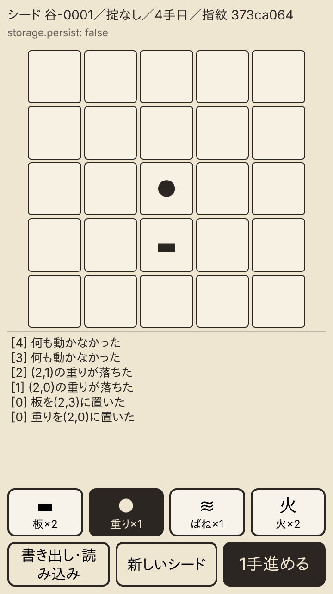

# 技術選定：継ぎ手の工房（仮）

書いた人：game-preprod-tech（2026-11-18）。初版。
もとにしたもの：`進行表.md`、`開発チーム.md`、`01_企画/企画書.md`、`02_プリプロ/デザインの柱.md`。途中で `02_プリプロ/アートディレクション.md`（同時に作業中だったもの）の描き方の前提も照らした。
前提（オーナーの決め）：スマホのブラウザが主（縦持ち片手）、PCブラウザも遊べる／サーバーなし・1人用・オフライン／ターン制／発明品の動きはマス目の決まった規則で計算／2D／保存は端末内＋書き出し・読み込み。

---

## 1. 結論

| 項目 | 選んだもの | 版（2026-11-18に確かめた） | ライセンス |
|---|---|---|---|
| 言語 | TypeScript | 7.0.2（型チェックだけに使う） | Apache-2.0 |
| ビルド | Vite | 8.3.8 | MIT |
| ゲームエンジン | **使わない**（ブラウザの機能だけ） | — | — |
| 描画 | DOM＋CSS＋インラインSVG（盤面・作業台・UIすべて） | ブラウザの機能 | — |
| 入力 | Pointer Events（タッチとマウスを同じコードで扱う） | ブラウザの機能 | — |
| 音 | Web Audio API（仮の音は合成音。本番の録音の音もこれで鳴らす） | ブラウザの機能 | — |
| 保存（端末内） | localStorage（1つのキーに、版つきの文字列で） | ブラウザの機能 | — |
| 保存（書き出し・読み込み） | 文字列（コピー・貼り付け）と、テキストファイル（ダウンロード・ファイル選択） | ブラウザの機能 | — |
| オフライン | Service Worker（読んだものをとっておく）＋ Web App Manifest（ホーム画面に置ける） | ブラウザの機能 | — |
| 乱数 | 自前の sfc32（シード付き、32bit の整数の演算だけ） | 自作（約30行） | 自作 |
| テスト | 規則の芯：Node の `node --test`／画面：Playwright（この環境の 1.63.0）＋Chrome for Testing 153 | Node 22.23.5 | Playwright は Apache-2.0 |

実行時に読み込む外部のライブラリは**ゼロ**。外部CDNも使わない。ビルドしたもの（`dist/`）だけで、どこに置いても動く。

### 選んだ理由（短く）
1. **このゲームの重さは「絵の速さ」ではなく「規則の計算と、文字の多い画面」**。ターン制・マス目・1画面に5×5〜7×7。帳面、年表、図鑑、家系図、癖と掟の札など、日本語の文が多い。DOM は日本語の文字の表示・折り返し・読み上げ（アクセシビリティ）がそのまま使え、ゲームエンジンの描画（WebGL）では自分で作り直すことになる
2. **アートの方向（線と平らな色のベクター、コードで描く）と合う**。部品の絵を SVG で作れば、DOM の中にそのまま置け、拡大しても線がぼけない（`アートディレクション.md` の「部品・地形・印・UI はコードで描く」と食い違いなし）
3. **決まった規則で再現できること（柱2）を、描画から切り離して守れる**。規則の計算（`src/core/`）は DOM も時間も `Math.random` も使わない純粋な TypeScript にした。同じコードが Node でもブラウザでも動き、指紋（ハッシュ）が一致することを実際に確かめた（5章）
4. **小さく、オフラインに強い**。最小の確認で、ゲームの JS は 8.7KB（圧縮前）。エンジンを入れると、それだけで Phaser 約1.38MB／PixiJS 約0.91MB（min.js、圧縮前）を毎回読む（3章）
5. **この環境で全部動かして確かめられる**。ビルド、型チェック、規則のテスト、Chromium でのスマホ相当の画面の試験まで、ここで回せた

---

## 2. 前提として読み取った技術の条件

| 条件 | どこから | 技術への意味 |
|---|---|---|
| スマホのブラウザが主、縦持ち片手。PCブラウザも | 進行表（オーナー） | 幅 360〜430 の縦画面で全部の操作。タッチとマウスの両方。親指の届く下半分に操作を集める |
| サーバーなし・1人用・オフライン | 開発チーム.md | 静的ファイルだけ。ネットワークは使わない。外部CDNに頼らない |
| ターン制・マス目の決まった規則 | 進行表（オーナー）、柱2 | なめらかな物理エンジンは要らない。整数のマス目の計算で足りる。毎フレームの更新ループも要らない（動いている間だけ描く） |
| 同じ組み方なら同じ動き。運で結果を変えない | 柱2 | 規則の計算は決定的に。乱数は「年代記の始まりで掟・棚・癖を引く」ためだけに、シード付きで使う |
| 次の1手で起きることを印で出す | 柱3、スコープ | 規則の計算を「写しで1手進めて比べる」ことが安く何度もできること（5×5で1手 約2µs、5章） |
| 保存は端末内＋書き出し・読み込み | 企画書リスク6、スコープ | ブラウザが保存を消すことがある（4章のリスク）。書き出しは必須 |
| 部品・UI の絵はコードで描くベクター、マス 44〜56px | アートディレクション.md | DOM＋SVG で描ける。Canvas の解像度の管理（端末の画素比）が要らない |

---

## 3. 候補の比較

比べたのは3つ。どれも MIT で、無料で商用にも使える（ライセンスの文は npm の配布物の LICENSE で確かめた）。

| | A：エンジンなし（TypeScript＋DOM／SVG＋Vite）**選んだ** | B：Phaser 4.2.1 | C：PixiJS 8.23.0 |
|---|---|---|---|
| どんなもの | ブラウザの機能だけで作る | 2Dゲームのエンジン（場面、入力、音、読み込み、物理） | 2Dの描画のライブラリ（WebGL/WebGPU） |
| 作りやすさ（このゲーム） | 盤面・UI・長い日本語の文がそのまま書ける。場面の切り替え、読み込み、音の管理は自分で書く（量は小さい） | 場面・音・入力がそろう。ただし日本語の文の多い画面（帳面、年表）は DOM を重ねるか、エンジンの文字で作り直す | 描画だけ。UI・入力・音・場面は自分で。DOM の UI と重ねることになる |
| 対象（スマホ縦・PC） | どちらも動く（5章で確かめた） | 動く（ここでは試していない） | 動く（ここでは試していない） |
| 性能 | 5×5〜7×7、ターン制では十分（CPU 6倍遅くしても1手 最大 約53ms、5章）。大量の粒子の演出には向かない | WebGL で大量の絵・粒子に強い。このゲームではその強さをあまり使わない | 同じく大量の描画に強い |
| 大きさ（ライブラリだけ、圧縮前／gzip） | 0（自作のコードだけ。確認版で 8.7KB） | phaser.min.js 1,375,976 B／約 355KB | pixi.min.js 912,519 B／約 256KB |
| 決まった規則の再現 | 規則の芯を描画から切り離して書く（どれでも同じ。エンジンは関係しない） | 同じ。内蔵の物理（Arcade/Matter）は使わない前提になる | 同じ |
| ライセンス | 自作（使う道具は MIT／Apache-2.0） | MIT | MIT |
| チームの手元（この環境）で動くか | 動かして確かめた | npm から入る。動かしてはいない | npm から入る。動かしてはいない |

外した候補：
- **Godot 4（Web への書き出し）**：WebAssembly で動く。公式の説明では、Web は WebGL 2（Compatibility の描画）だけ、C# の計画は Web に書き出せない、スマホでは WebAssembly のため CPU・GPU の余裕が小さい。読み込みが大きくなり、この環境ではエディタも書き出しのひな形もなく、動かして確かめられない。日本語の文の多い画面も DOM より手間が要る
- **Unity など、ネイティブ寄りのエンジン**：同じ理由（ブラウザ向けの読み込みが大きい、この環境で確かめられない）で外した。比べる表には入れていない

あとで B・C に移る余地：規則の芯（`core/`）は描画に依存しないので、演出が重くなって DOM で足りなくなったら、**盤面の描画だけ**を Canvas 2D か PixiJS に替えられる。替えるかの判断は 08 統合・演出の性能の計測で（4章 R7）。

---

## 4. 選んだ構成の決まり（05 本格的な開発開始への申し送り）

### 4.1 フォルダの分け方（確認版の形。本番は game-prod-architect が決める）
```
src/core/   規則の計算・乱数・保存の形（DOM・時間・Math.random を使わない。Node でテストできる）
src/        画面・入力・音（core を呼ぶだけ）
public/     sw.js（オフライン）、manifest
test/       core のテスト（node --test）、画面のテスト（Playwright）
```

### 4.2 決まった規則で再現するための決まり
- `src/core/` では、`Math.random`、`Date`、`performance.now`、DOM を使わない
- 数は**整数だけ**。小数が要る量（重さの比、傷み）は、整数の固定小数点（例：×1000）で持つ。三角関数・平方根は使わない（エンジンごとの丸めの差を避ける）
- 1手の中の順番は、配列の決まった順で回す。同じマスで規則がぶつかったときの順番（燃えながら落ちる、など）は**仕様で決めてから**書く（デザインの柱.md の「後の部門に渡すこと」、03・game-design-systems）
- 乱数はシード付きの sfc32 だけ。年代記・代・課題ごとに、シードから**別々の乱数の流れ**を作る（例：`シード + "/代3/掟"`）。ある流れで引く数が変わっても、ほかの流れがずれないようにする
- 「次の1手の印」は、盤面の写しで1手進めて比べて出す（確認版の `preview()`）。本番と同じ関数を使うので、印と実際がずれない

### 4.3 保存の形
- 端末内：localStorage の1つのキーに、書き出しと同じ文字列を入れる。手を確定するたび・課題ごとに書く（スコープの「課題ごとの自動保存」）
- 書き出しの文字列：`YK1.<中身（JSON を base64url）>.<指紋>`。読み込むときに、①頭の版、②指紋、③**シードと操作の記録から作り直した盤面の指紋**、の3つを照らす。③で「規則の版が変わって、同じ記録から同じ盤面にならない」ことに気づける
- 保存には、盤面そのものと、シード＋操作の記録の両方を入れる。記録は「解き方の図鑑」「年表」の材料にもなる（記録が長くなりすぎたら、代ごとに切って要約する。R3）
- ファイルの書き出しは、テキストファイル（`.txt`）のダウンロード。**ファイル名は英数字だけ**にする（日本語にすると Chrome でファイル名が `download` になった。5章）
- IndexedDB は今は使わない。保存の大きさを測って、localStorage で足りなくなったら移す（R3）

### 4.4 画面・入力・音
- 縦画面の高さは `100dvh`、端末の切り欠きは `env(safe-area-inset-*)` で避ける
- 盤面・棚・ボタンに `touch-action: none`（盤面）／十分な大きさ（棚 52px 以上、ボタン 48px 以上）
- 入力は Pointer Events。棚→盤のドラッグと、棚をタップ→盤をタップ、の両方を用意する
- 棚から始めたドラッグでは `touchmove` の既定の動作を止める（止めないと、ドラッグ直後の1回のタップで click が出なかった。5章）
- 音は最初のタップで AudioContext を起こす（スマホは、人の操作の前に音を鳴らせない）
- 音の情報はすべて絵でも出す（アートディレクション.md の決めと同じ）

### 4.5 オフライン
- Service Worker で、一度開いたものをとっておき、次からはネットなしで開ける（5章で確かめた）
- Service Worker は **https か localhost でしか動かない**。オーナーのスマホに届けるとき、PC の LAN の IP（http）で開くとオフラインと一部の保存の機能が効かない（R10）
- 本番では、版ごとにとっておく場所の名前を変え、新しい版が出たら知らせる（05 で）

---

## 5. 最小の「動く」を作って確かめた

置き場所：`02_プリプロ/tech_check/`（捨てる前提）。中身は、縦長の画面に 5×5 のマス、下に部品の棚（板・重り・ばね・火）、「1手進める」、書き出し・読み込み。規則は4つだけ（重りは落ちる、ばねの上の重りは2マス跳ねる、火は隣の板に燃え移り2手で消える、時代の掟（大風：落ちた重りが東へ流れる／長雨：火が燃え移らない））。掟と棚の数はシードから引く。


（`npm run e2e` を流すと、4つの画面ぶんが `tech_check/test-results/` にできる。`test-results/` は git に入れない）

### 5.1 動かし方（このフォルダで）
```
cd ゲーム/yarikomi/02_プリプロ/tech_check
npm install            # vite 8.3.8, typescript 7.0.2（devDependencies だけ）
npm run typecheck      # tsc -p .
npm test               # node --test test/core.test.ts（規則の芯、Node で）
npm run build          # vite build → dist/
npm run e2e            # node test/e2e.mjs（dist を vite preview で出し、Chrome for Testing で確かめる）
npm run dev            # 手で触るとき（http://localhost:5173/）
```
Playwright はこの環境の全体に入っているもの（`/opt/node-tools/node_modules/playwright`、1.63.0）と、`/usr/bin/google-chrome`（Chrome for Testing 153.0.8010.12）を使った。

### 5.2 結果（2026-11-18、この環境）

`npm run typecheck`：エラーなし。`npm run build`：`dist/assets/index-*.js` 8,724 B。

`npm test`（Node 22.23.5）：**9/9 通った**
| テスト | 結果 |
|---|---|
| 同じシードなら同じ乱数の列、違うシードなら違う列。最初の値を固定値 `529f9503` と照合 | 通る |
| シードから掟と棚が決まる。200個のシードで3つの掟が全部出る | 通る |
| 重りは落ちて床で止まる／板の上で止まる／ばねで2マス跳ねる | 通る |
| 火は1手で隣の板1マスに移り、2手で消える。長雨では移らない | 通る |
| 大風で、落ちた重りが東へ流れる | 通る |
| でたらめな入力1万手のあと、記録から作り直すと同じ指紋。指紋を固定値 `120aa3a5` と照合 | 通る |
| 書き出し→読み込みで同じ。1文字変えると断る。違う版の頭は断る | 通る |
| 速さ：5×5で10万手 約170〜180ms（1手 約1.7〜1.8µs） | 目安 |

`npm run e2e`：**85/85 通った**（4つの画面×確かめること）
画面：①Pixel 7 相当（412×839、タッチ）、②390×844（iPhone 相当の**大きさと UA だけ**。中身は Chromium）、③360×640（小さめの Android、アートディレクションの基準の大きさ）、④PC 1280×800（マウス）。

| 確かめたこと | 結果 |
|---|---|
| 5×5 のマスが画面に収まる／マスが 44px 以上 | 通る（マス 58〜72px） |
| 棚と「1手進める」が画面の下半分（タッチの3つ） | 通る（360×640 で棚 y=526、ボタン y=584） |
| 横スクロールが出ない | 通る |
| タップで部品を置ける／棚から盤へドラッグで置ける（タッチは CDP で指の動きを送った） | 通る |
| 次の1手で変わるマスに印が出る | 通る |
| 「1手進める」4回で、重りが落ちて板の上で止まる | 通る |
| ブラウザの盤面の指紋 ＝ 同じ記録を Node で作り直した指紋 | 通る |
| ブラウザの中で、乱数の最初の値と1万手の指紋が Node の固定値と同じ | 通る |
| 音：最初のタップで AudioContext が `running`、置く・進めるで音を鳴らす呼び出しがある | 通る |
| 音：OfflineAudioContext で同じ音を作り、波形が無音でない（最大 0.28） | 通る |
| 再読み込みで続きから（localStorage） | 通る |
| ファイルのダウンロードの中身 ＝ 文字の書き出し | 通る |
| 保存を消したあと、文字から／ファイルから読み込んで元どおり | 通る |
| 1文字変えた書き出しは読み込みを断り、盤面は変わらない | 通る |
| オフライン：Service Worker が付いたあと、ネットを切って開き直しても遊べる | 通る |
| 外部への通信がない（CDN なし） | 通る |
| ページのエラーがない | 通る |
| CPU を4倍・6倍遅くして、1手（規則＋印の計算＋描き直し）から次の描画まで | 中央 約16〜22ms、最大 約20〜53ms（3回流した範囲。100ms 未満を通るとした） |

途中で見つかって直したこと：
1. **ドラッグの直後のタップが1回効かない**：棚（`touch-action: none`）から盤へ指でドラッグしたあと、次の1回のタップで click が出なかった（4回押して3手しか進まない）。棚の `touchmove` で既定の動作を止めたら直った。Chrome のタッチのエミュレーションで見つけたもので、**実機で同じことが起きるかは確かめていない**
2. **日本語のファイル名がダウンロードで `download` になる**（Chrome for Testing 153）。英数字だけのファイル名にした
3. （テストの道具の問題）Playwright の `setInputFiles` に日本語を含むパスを渡すと、何も選ばれず、エラーも出なかった。ファイルの中身を渡す形にした。ゲームの不具合ではない

### 5.3 確かめられなかったこと（正直に）
- **実機**：スマホの実機では一度も動かしていない。この環境には実機がない。すべて Chromium のエミュレーション（画面の大きさ、タッチ、CPU を遅くする）
- **iPhone の Safari（WebKit）**：iPhone のブラウザはこのゲームの主な遊び場になりうるが、ここでは試せなかった。Playwright の WebKit を入れようとしたが、配布元への接続がこの環境で許されておらず、入らなかった。390×844 の試験は「大きさと UA が iPhone 相当」なだけで、中身は Chromium
- **Firefox**：試していない
- **音が実際に耳に聞こえるか**：AudioContext が動き、波形が無音でないことまで。スピーカーから聞こえるか、iPhone の消音スイッチでどうなるかは確かめていない
- **ホーム画面に追加したときの動き**、端末の保存が消される条件（7日など）、`navigator.storage.persist()` の結果が実機でどうなるか（ここでは `false`）
- **電池の減り**、長い時間遊んだときの動き
- **規則が多くなったとき（5つの規則、7×7、敵）の速さ**：今の確認は規則4つ・5×5だけ

---

## 6. 技術リスクと確かめ方

| # | リスク | 起きたら | 大きさ | 今の手 | 確かめ方・いつ |
|---|---|---|---|---|---|
| R1 | **iPhone の Safari が端末内の保存を消す**。WebKit は、Safari で7日使われなかったサイトのスクリプトの保存（localStorage・IndexedDB）を消す方針（2020年から）。ホーム画面に追加したアプリは、Safari と別の数え方とされる | 数時間の年代記が消える | 大 | 書き出しを必須に（スコープどおり）。最後の書き出しからの日数を画面に出し、促す。ホーム画面への追加を勧める | オーナーの iPhone で、①Safari で開いたまま8日以上触らない、②ホーム画面から同じことをする、の2つで保存が残るか見る（04 プロトタイプ。期間がかかるので早めに始める） |
| R2 | `navigator.storage.persist()` が効かない（ここでは `false`。WebKit は「ホーム画面のアプリか」などで判断するとされ、macOS の Safari 17 で常に `false` になるという報告もある） | 保存が消えうる状態のまま | 中 | 頼らない。R1 と同じ手 | 実機の Chrome（Android）と Safari で結果を記録する（04） |
| R3 | 保存が大きくなる（操作の記録は手を打つたびに伸びる）。localStorage の上限の数字は、公式の資料を直接確かめられなかった | 保存に失敗する（QuotaExceededError） | 中 | 今の確認版は6手で 855 バイト。記録は代ごとに切り、要約（年表・図鑑）だけを残す形を 03 で決める | 03 の仕様で年代記1本の手数の見込みを出し、それで保存の大きさを計算する。05 で、上限に近づいたら IndexedDB に移すかを決める。書き込みの失敗をつかまえて知らせる |
| R4 | **規則の計算が、どこかで決定的でなくなる**（小数、順番の決まっていない回し方、`Math.random` の混入） | 同じ組み方で違う動き（柱2が壊れる）、書き出しが読めない | 大 | 4.2 の決まり。指紋の固定値のテスト、記録から作り直して指紋を照らすテスト、Node とブラウザで指紋を比べるテスト | 05 で同じテストを CI のように毎回流す。規則を足すたびに、でたらめな入力の長いテストを足す（06） |
| R5 | **規則の版が変わると、古い書き出しが読めない／違う盤面になる** | オーナーの年代記が、更新で壊れる | 大 | 書き出しに版の頭。読み込みで「記録から作り直した指紋」を照らし、合わなければ断る | 05 で、版の移し替え（古い版→新しい版）を書くか、「その年代記は古い規則のまま続ける」かを決める（未決） |
| R6 | **iPhone の Safari（WebKit）で、タッチ・音・ダウンロードの動きが Chromium と違う**。特に、blob のダウンロードの挙動、AudioContext の起こし方、消音スイッチ | 書き出しができない、音が鳴らない | 中 | 書き出しは「文字をコピー」を主、ファイルは従にする。ファイルが使えないときの道（共有シート＝Web Share API）は候補 | オーナーの iPhone と Android で、5.2 の表と同じことを手で確かめる（04。チェック表は 04 で作る）。WebKit の自動テストは、配布元への接続が許されたら足す |
| R7 | 演出が増えて DOM の描き直しが重くなる（墨のにじみ、粒子、早送り） | 1手の動きがかくつく、電池が減る | 中 | 今は1手 最大 約53ms（CPU 6倍遅い）。毎フレームのループを回さず、動いている間だけ描く | 08 で、実機で1手の再生のフレームの時間を測る。足りなければ盤面だけ Canvas 2D か PixiJS に替える（規則の芯は替えない） |
| R8 | ドラッグとタップがぶつかる（ドラッグ直後のタップが消える、置き間違い） | 置き間違い、押したのに効かない | 中 | `touchmove` を止めて直した（エミュレーションで）。タップで選んで置く道も残す | 04 のプレイテストで「置き間違いの回数」を見る（デザインの柱の問い1）。実機で、ドラッグ直後のタップが効くか |
| R9 | 画面の高さの違い（アドレスバーの伸び縮み、切り欠き、キーボード） | 下のボタンが隠れる | 小〜中 | `100dvh`、`safe-area-inset` | 実機（iPhone・Android）で、アドレスバーが出たとき・消えたときに下のボタンが見えるか（04） |
| R10 | **オーナーのスマホへの届け方**。Service Worker は https か localhost でしか動かない。PC の LAN の IP（http）で開くと、オフラインが効かない | オフラインで遊べない、保存の動きが本番と違う | 中 | 未決（7章） | 届け方が決まったら、その形で5.2のオフラインの試験をする |
| R11 | 日本語フォントが大きい（アートディレクション.md） | 最初の読み込みが重い、オフラインのとっておきが大きい | 小〜中 | 今は端末のフォント（system-ui） | フォントが決まったら、使う字だけに絞ったときの大きさを測る（07、art-ui と） |
| R12 | 本番の音（録音・曲）のファイル形式が、iPhone と Android の両方で鳴るか | 片方で鳴らない | 小〜中 | 仮は合成音なのでファイルなし | 05 で audio-engineer と形式を決め、実機の両方で鳴らす（形式ごとの対応は、ここでは確かめていない） |
| R13 | 開発の道具の脆弱性：Vite 8.3.8 が依存する picomatch に、`npm audit` で ReDoS の指摘（4件 high、GHSA-fc5q-39xc-vjpf） | 開発のときだけの道具なので、遊ぶ人には届かない | 小 | 本番のファイル（`dist/`）には入らない | 05 で `npm audit` を見て、直った版が出たら上げる |
| R14 | TypeScript 7 は新しい大きな版（2026-07） | 型チェックが変わる、道具が合わない | 小 | 型チェックだけに使い、変換は Vite がする | 05 で問題が出たら、前の大きな版に戻す |
| — | 物理 | なめらかな物理は使わない（オーナーの決め）ので、物理エンジンのリスクはない。代わりに「同じマスでぶつかる順番」の仕様の抜けがリスク（R4 に含む） | — | — | 03 の仕様のレビュー |
| — | ネットワーク | 使わない。シードの共有（あれば）は文字列で | — | — | — |

---

## 7. 未決

オーナーに聞くこと：
- **スマホへの届け方**：オーナーのスマホでビルドを開く方法（静的ファイルを置く場所に https で置く、など）。置く操作はこのスタジオではしない。決まるまで、04 プロトタイプの実機確認ができない（R10）
- オーナーの端末の機種（iPhone か Android か、OS の版）。R1・R6 の確かめ方が変わる

05 本格的な開発開始で決めること（game-prod-architect、game-prod-pipeline と）：
- 規則の版が変わったときの古い保存の扱い（移し替えるか、古い規則のまま続けるか）（R5）
- 保存の記録の切り方と、IndexedDB に移す基準（R3）
- Service Worker の更新のしかた（新しい版の知らせ方）
- 自動テストの回し方（`npm test` と `npm run e2e` を毎回）

ほかの担当に渡すこと：
- 同じマスで規則がぶつかったときの順番（03、game-design-systems）。決まらないと、決定的に書けない
- 盤面を DOM のままにするか、演出のために Canvas 2D／PixiJS に替えるか（08、game-tech-performance。実機の計測しだい）
- 音の本番のファイル形式（05・08、game-audio-engineer）
- フォントと、使う字への絞り方（07、game-art-ui）

---

## 8. 出典

版とライセンス（2026-11-18 に `npm view` で npm の公式の登録から取り、配布物の LICENSE の文も見た）：
- [phaser（npm）](https://www.npmjs.com/package/phaser)：4.2.1（2026-07-09）、MIT。`dist/phaser.min.js` 1,375,976 B
- [pixi.js（npm）](https://www.npmjs.com/package/pixi.js)：8.23.0（2026-11-11）、MIT。`dist/pixi.min.js` 912,519 B
- [vite（npm）](https://www.npmjs.com/package/vite)：8.3.8、MIT
- [typescript（npm）](https://www.npmjs.com/package/typescript)：7.0.2（2026-07-08）、Apache-2.0
- Playwright 1.63.0（この環境に入っているもの）、Apache-2.0

ブラウザ・エンジンの仕様（この環境から公式のページを直接開けなかったものは、検索の結果の要約で確かめた。公式のページを人が開いて確かめ直すこと）：
- [Godot Docs：Exporting for the Web](https://docs.godotengine.org/en/stable/tutorials/export/exporting_for_web.html)（Web は WebGL 2 の Compatibility の描画だけ、C# は Web に書き出せない、スマホでは WebAssembly で余裕が小さい）※直接は開けず、検索の結果から
- [WebKit：Updates to Storage Policy](https://webkit.org/?p=14403)（Safari 17 で Storage API に対応、`persist()` はホーム画面のアプリかなどで判断）※直接は開けず、検索の結果から
- [WebKit Bug 271401：navigator.storage.persist() always return false](https://bugs.webkit.org/show_bug.cgi?id=271401)（報告。直ったかはわからない）
- [WebKit Bug 237350：Web App Added to Home Screen Cookies Deleted After 7 Days](https://bugs.webkit.org/show_bug.cgi?id=237350)、[iTnews：Apple cops flak for deleting local browser storage after 7 days](https://www.itnews.com.au/news/apple-cops-flak-for-deleting-local-browser-storage-after-7-days-539833)（Safari 13.1／iOS 13.4 からの7日の上限、ホーム画面のアプリは別の数え方）※2020〜2022年の資料。今の版で同じかは実機で確かめる（R1）
- [MDN：Storage quotas and eviction criteria](https://developer.mozilla.org/docs/Web/API/Storage_API/Storage_quotas_and_eviction_criteria) ※この環境から開けなかった。localStorage の上限の数字は確かめていない（R3）
